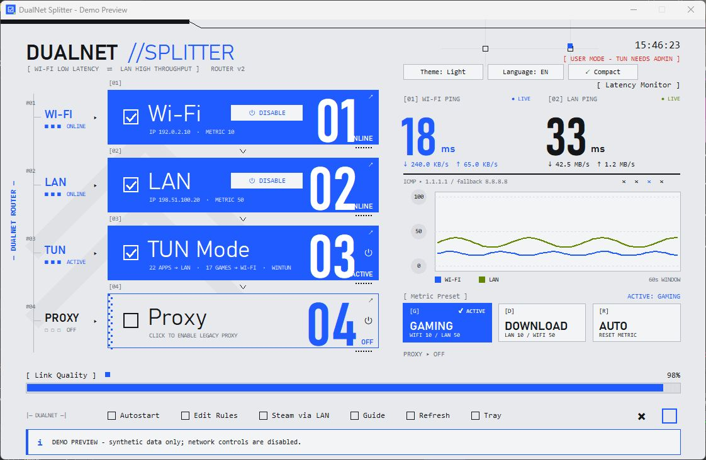
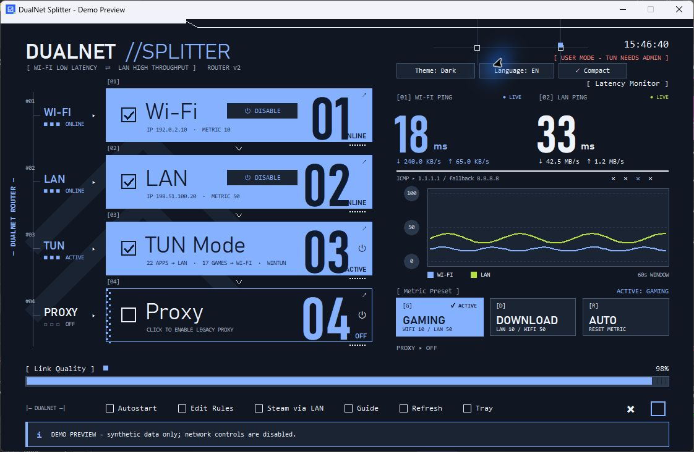
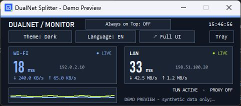

# DualNet Splitter — Wi-Fi & Ethernet Traffic Routing for Windows

Route games and voice chat over Wi-Fi while sending selected downloads over Ethernet. DualNet Splitter is a Windows desktop app for **per-application network routing**, with a **TUN virtual adapter**, **HTTP/SOCKS5 proxy**, live latency monitoring, and separate bandwidth meters.

[](https://github.com/AhmadNadaStudent/DualNet-Splitter/releases/latest)
[](https://github.com/AhmadNadaStudent/DualNet-Splitter/actions/workflows/ci.yml)


**[Download for Windows](https://github.com/AhmadNadaStudent/DualNet-Splitter/releases/latest)** · [Quick start](#quick-start) · [Compatibility](#compatibility) · [Routing rules](#customize-per-application-routing) · [Troubleshooting](#troubleshooting)



*Real app screenshot in demo mode. All IP addresses, latency values, and traffic rates are synthetic. No personal network information is shown.*

## Why use DualNet Splitter?

Downloading a game update while playing or joining a voice call can compete for the same connection. If your PC has two usable network paths, DualNet lets you choose which applications use each one:

- Keep games, Discord, and other latency-sensitive processes on Wi-Fi.
- Route Steam, download managers, torrent clients, and other selected processes to Ethernet.
- See ping and download/upload rates for each physical adapter.
- Change the preferred Windows default route with Gaming, Download, or Automatic metric presets.

**DualNet splits traffic between connections. It does not bond connections or combine two internet speeds into one download.** Results depend on both network paths, your router, ISP, and application behavior. Two adapters connected to the same congested upstream connection can still share the same bottleneck.

## Features

| Feature | What it does |
| --- | --- |
| Process-based TUN routing | Uses sing-box and Wintun to select a network adapter by executable name. |
| Local HTTP and SOCKS5 proxy | Optional loopback-only HTTP proxy at `127.0.0.1:8080` and SOCKS5 at `127.0.0.1:1080`. |
| Live network monitoring | Per-adapter ICMP latency, ping history, and download/upload rates from Windows interface counters. |
| Adapter controls | Enable or disable detected physical adapters and inspect their connection state. |
| Metric presets | Gaming prioritizes Wi-Fi; Download prioritizes Ethernet; Auto enables Windows automatic metrics. |
| Portable hardware detection | Detects adapter types independently of their brand or display name, including renamed adapters and USB Ethernet adapters reported correctly by Windows drivers. |
| Compact monitor | Small monitoring window with an optional always-on-top setting. |
| Light and dark themes | Switch themes without restarting the routing service. |
| English and Indonesian UI | Change the interface language from the dashboard. |
| System tray and autostart | Optional elevated Windows Task Scheduler startup and a persistent tray icon. |
| Verified runtime downloads | Architecture-specific sing-box and Wintun downloads are checked against pinned SHA-256 hashes before installation. |

## Quick start

1. Download `DualNet-Splitter-v1.0.0-windows-x64.zip` from [Releases](https://github.com/AhmadNadaStudent/DualNet-Splitter/releases/latest).
2. Extract the entire ZIP into a writable folder. Keep `DualNet.exe` and `routing_rules.json` together. Python is not required for the packaged app.
3. Connect Wi-Fi and Ethernet. Verify that each connection can reach the internet independently.
4. Open `DualNet.exe` and approve the Windows administrator prompt. The packaged executable requests elevation for network controls.
5. Select **Language: EN** if you prefer English, then use **Guide** or **F1** for the walkthrough.
6. Click **Refresh** and confirm both adapters appear. Choose the **Gaming** preset if you want Wi-Fi to be the preferred Windows route.
7. Enable **TUN Mode**. The first activation downloads the pinned sing-box core and Wintun driver from their official upstream servers; allow time for this step.
8. Edit the process lists if needed. Save the file, then turn TUN off and on to apply changes.

Use **TUN Mode** for transparent process routing. The proxy is optional and only affects applications explicitly configured to use it.

To stop routing, disable TUN or use the app's exit control. Closing the window while TUN is active hides the app to the tray. Metric presets persist in Windows after exit; select **Auto** to enable Windows automatic metrics. Auto does not restore a previous custom metric configuration.

## Compatibility

| Environment | Support |
| --- | --- |
| Windows 10 / Windows 11 x64 | Intended release target. The included executable is built and locally checked on Windows x64. |
| Renamed Wi-Fi / Ethernet adapters | Detected using Windows interface types rather than fixed names. |
| Other adapter brands / USB Ethernet | No vendor-specific model requirement; depends on correct physical-interface metadata from the driver. |
| Multiple adapters of one type | Automatically prefers a connected adapter with a usable address, then metric and interface index. Manual adapter selection is not currently available. |
| Windows ARM64 / 32-bit Windows | Source runtime download selection is implemented; no native packaged release or end-to-end hardware validation is provided. Use a matching Python runtime if experimenting. |
| macOS, Linux, Android, iOS | Not supported. The app depends on Windows networking APIs and PowerShell cmdlets. |

Use Python **3.12 or newer** for source development. A native 64-bit Python runtime is required for the x64 release builder. The dashboard scales down to fit smaller laptop screens; 1280 × 720 or higher is recommended.

Both connections need working drivers. This release is designed for one Wi-Fi path plus one Ethernet path, not two Wi-Fi networks. Disabling an adapter interrupts connections using it. VPNs, virtual adapters, endpoint security, and game policies can affect routing; no universal anti-cheat compatibility or latency improvement is guaranteed.

## How routing works

```text
Windows applications
        |
        v
DualNet TUN adapter (sing-box + Wintun)
        |
        +-- Selected download processes ---> Ethernet
        |
        +-- Selected gaming processes ----> Wi-Fi
        |
        +-- Other processes / default ----> Wi-Fi
```

The supplied rules use Wi-Fi as the TUN default. If Ethernet is unavailable when TUN starts, download-specific Ethernet rules are omitted. Restart TUN after changing adapters or reconnecting a different network. If the selected adapter disappears during a session, existing connections can fail.

Metric presets control Windows' preferred IPv4 route. Process rules in TUN mode explicitly bind their own outgoing interfaces and take precedence for those connections. Proxy mode handles TCP traffic; it is not a general UDP game proxy. The app's adapter discovery, metric controls, and proxy binding focus on IPv4; IPv6-only networks are not a validated target.

## Customize per-application routing

Use **Edit Rules** or edit `routing_rules.json` beside the executable. Entries are executable file names, not full paths, account names, URLs, or passwords.

```json
{
  "download_processes": [
    "steam.exe",
    "steamservice.exe",
    "idman.exe",
    "qbittorrent.exe",
    "EpicGamesLauncher.exe"
  ],
  "gaming_processes": [
    "cs2.exe",
    "VALORANT-Win64-Shipping.exe",
    "dota2.exe",
    "Discord.exe"
  ],
  "default_outbound": "wifi"
}
```

The default file includes additional example processes. Keep a process in only one list: download rules are evaluated first. A launcher and a game may run under different executable names. Routing a process routes its traffic, including its sign-in and update connections; it does not distinguish individual requests inside that process.

After editing, save the file and restart TUN. If the JSON cannot be loaded, the app falls back to its built-in default rules.

## Optional proxy mode

Enable **Proxy** and configure the client application with either:

| Protocol | Host | Port |
| --- | --- | --- |
| HTTP / HTTP CONNECT | `127.0.0.1` | `8080` |
| SOCKS5 TCP | `127.0.0.1` | `1080` |

For example, IDM exposes proxy settings in its options. Client support varies. The **Steam via LAN** shortcut passes an optional proxy flag; Steam may ignore it, so prefer TUN process rules for Steam downloads. If Ethernet cannot be bound, the legacy proxy can fall back to Windows routing; it is not a strict Ethernet-only kill switch.

The proxy binds only to the local computer and does not change the system-wide proxy setting. Port conflicts are reported without terminating the unrelated application.

## Screenshots

### Dark dashboard



### Compact latency and bandwidth monitor



All screenshots use the isolated demo in `tests/preview_gui.py`. It disables network discovery, ping, traffic sampling, routing controls, autostart, and tray startup. The sample addresses belong to documentation ranges and do not identify a real network.

## Run from source

```powershell
git clone https://github.com/AhmadNadaStudent/DualNet-Splitter.git
cd DualNet-Splitter
py -3.14 -m venv .venv
.\.venv\Scripts\python.exe -m pip install -r requirements-dev.txt
.\.venv\Scripts\python.exe gui.py
```

Run the source terminal with elevation for TUN and network changes. For windowless launches, `start.bat` prefers a packaged executable when present, then searches for a Python launcher. `start_cli.bat` opens the terminal dashboard. Activate the virtual environment before using batch helpers so they use the intended dependencies.

Legacy metric helpers now discover physical adapters instead of assuming the literal names `Wi-Fi` and `Ethernet`:

- `set_metrics.bat`: Gaming preset.
- `switch_to_lan.bat`: Download preset.
- `reset_metrics.bat`: Windows automatic metrics.

For the packaged application, use the GUI's **Autostart** control. Source users can also use `install_autostart.bat` and `uninstall_autostart.bat`. Autostart is optional and registers an elevated logon task; keep the application in the same folder while that task is installed.

## Build and test

```powershell
python -m pip install -r requirements-dev.txt
python -m unittest discover -s tests -v
python tools/build_release.py
```

The builder creates a Windows x64 ZIP and `release/SHA256SUMS.txt`. It packages an explicit list of files and dependency license notices. It excludes local preferences, generated TUN configuration, runtime logs, downloaded routing binaries, caches, old executables, and development state.

To verify a release download:

```powershell
Get-FileHash .\DualNet-Splitter-v1.0.0-windows-x64.zip -Algorithm SHA256
```

Compare the value with the matching line in `SHA256SUMS.txt` from the same release. The executable is not Authenticode-signed.

Create your own privacy-safe preview:

```powershell
python tests/preview_gui.py
python tests/preview_gui.py --dark
python tests/preview_gui.py --dark --compact
```

The [Windows checks workflow](https://github.com/AhmadNadaStudent/DualNet-Splitter/actions/workflows/ci.yml) runs the test suite with Python 3.12 and 3.14 and builds an x64 artifact. Unit tests cover adapter selection, controls, UI layout, metrics, bandwidth counters, preferences, and verified downloads; they do not establish performance on every router or physical adapter.

## Privacy

There is no analytics uploader or account sign-in in DualNet. Adapter addresses and traffic counters are read locally. Live ping probes contact `1.1.1.1`, with `8.8.8.8` as a fallback; the generated TUN configuration uses `1.1.1.1` for DNS. First-run runtime downloads contact GitHub and wintun.net.

Generated configuration and runtime logs may contain local interface names, IP addresses, process names, or connection destinations. These files remain local and are ignored by Git. Do not attach them to public issues without reviewing and redacting them. Public release screenshots use synthetic data only. See [SECURITY.md](SECURITY.md).

## Troubleshooting

| Symptom | What to check |
| --- | --- |
| Wi-Fi or Ethernet missing | Enable the adapter, check its driver, connect it, and click Refresh. Virtual/VPN/Bluetooth interfaces are intentionally filtered out. |
| Adapter enabled but no IP | Wait for DHCP, reconnect Wi-Fi or the cable, then refresh. Enabled does not mean connected. |
| TUN fails to start | Run as administrator, verify internet access for the first download, and check whether another VPN/TUN conflicts. Review the local log privately. |
| Checksum mismatch | The download is rejected. Retry later from a stable connection; do not disable verification. |
| No ping value | ICMP may be blocked even when browsing works. Check connectivity separately. |
| Download uses the wrong route | Confirm the actual executable name, save rules, restart TUN, and start a new download connection. |
| Proxy port already in use | Close or reconfigure the conflicting service, or use TUN instead. DualNet will not kill it. |
| Want the normal Windows route | Turn off TUN and Proxy, then select Auto. Existing custom metrics are not backed up by the preset system. |
| Startup points to an old folder | Disable Autostart, move/extract the app to its final location, then enable it again. |

## FAQ

**Can I use Wi-Fi and Ethernet at the same time on Windows?**

Yes, when Windows and the drivers expose both connections. DualNet adds process-based interface routing and monitoring on top of those adapters.

**Will this lower ping or make downloads faster?**

It can separate competing applications across available paths. It cannot fix an ISP bottleneck or guarantee a particular ping or speed.

**Does it work with any Wi-Fi or Ethernet brand?**

It uses Windows interface types rather than a brand allowlist. Actual compatibility still depends on the driver, network configuration, and the upstream TUN core.

**Does this require Python?**

The Windows x64 release does not. Running or building from source does.

## Feedback and third-party licenses

Report reproducible bugs in [GitHub Issues](https://github.com/AhmadNadaStudent/DualNet-Splitter/issues). Include Windows version, app version, adapter type, and reproduction steps. Redact IP addresses, user paths, identifiers, and logs before sharing.

DualNet uses independent projects including [sing-box](https://github.com/SagerNet/sing-box) and [Wintun](https://www.wintun.net/). See [third-party notices](THIRD_PARTY_NOTICES.md) for sources and licenses. No project-wide license has been selected for DualNet's own source.
