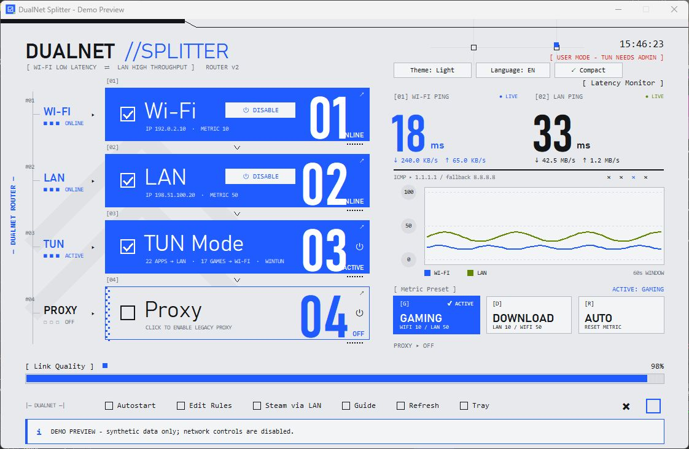

# DualNet Splitter v1.0.0

First public Windows release of DualNet Splitter: route games and voice chat through Wi-Fi while directing selected downloads through Ethernet.

## Highlights

- Process-based TUN routing with sing-box and Wintun.
- Optional local HTTP / SOCKS5 TCP proxy.
- Live Wi-Fi and Ethernet ping, bandwidth meters, and ping history.
- Gaming, Download, and Windows Automatic metric presets.
- Light/dark themes, English/Indonesian UI, compact monitor, system tray, and optional autostart.
- Vendor-independent adapter detection, renamed adapter support, connected-adapter prioritization, and Steam installation discovery.
- Architecture-aware runtime downloads with pinned SHA-256 verification.
- Privacy-safe screenshots, sanitized source, ignored local configuration/logs, and an allowlisted release package.
- Occupied proxy ports report an error without killing other applications; TUN shutdown targets only its owned child process.

## Download and run

1. Download **DualNet-Splitter-v1.0.0-windows-x64.zip** and extract the complete archive to a writable folder.
2. Run **DualNet.exe** and approve elevation. No Python installation is needed.
3. Connect Wi-Fi and Ethernet, click Refresh, then enable TUN Mode.
4. The first TUN activation downloads verified sing-box 1.14.4 and Wintun 0.14.1 from their official upstream servers. These routing binaries are not bundled in the ZIP.
5. Customize **routing_rules.json** and restart TUN to apply changed process lists.

Compare the ZIP's SHA-256 hash with **SHA256SUMS.txt** from this release. The executable is unsigned. Bundled dependency license notices are included in the ZIP.

## Compatibility and limits

- Packaged target: **Windows 10/11 x64**. Built and locally checked on Windows x64.
- Other physical Wi-Fi/Ethernet brands, renamed adapters, and USB Ethernet are detected through Windows interface metadata; individual hardware combinations have not all been tested.
- ARM64/x86 runtime selection is implemented for source users; no native ARM64/x86 packaged release or end-to-end validation is included.
- macOS, Linux, Android, and iOS are not supported.
- This is traffic splitting, not bandwidth bonding. Lower latency and higher throughput are not guaranteed.
- Routing is designed around IPv4-capable networks. Proxy mode is TCP-only and may fall back to Windows routing when Ethernet is unavailable.
- Preset metrics persist after exit; select Auto to enable Windows automatic metrics. Previous custom metrics are not backed up.
- Screenshot values are simulated and contain no real network information.

## Validation

All 41 local tests passed. They cover UI layout, themes/languages, tray behavior, adapter controls, metric verification, bandwidth counters, preferences, architecture selection, checksum rejection, and portable adapter detection. The generated TUN configuration also passed sing-box 1.14.4's configuration check without activating networking. Physical network routing across other PCs is not certified by these checks.

Read the repository README for setup, privacy details, troubleshooting, screenshots, and source build instructions.

## Preview

This is a real app capture using synthetic telemetry and documentation-only IP addresses. No personal network information is included.
